# 🥗 Sano — Escaneo y calificación de alimentos: app móvil, dashboard de escritorio, API y landing

🌐 [English](README.md) · **Español**

Un producto completo que convierte el código de barras de un producto en una **calificación de 0 a 100** con contexto de sellos **NOM-051**, aditivos explicados y alternativas más saludables. Diseñé y construí cada pieza: la **app móvil**, el **dashboard de operación de escritorio**, el **gateway en NestJS**, un **asistente de IA local** que lee fotos de empaques y la **landing de lanzamiento**.

  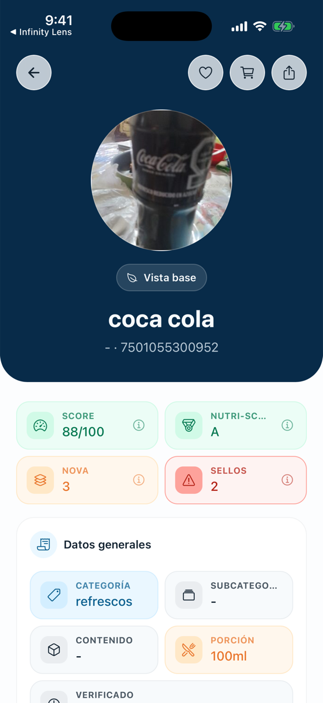
  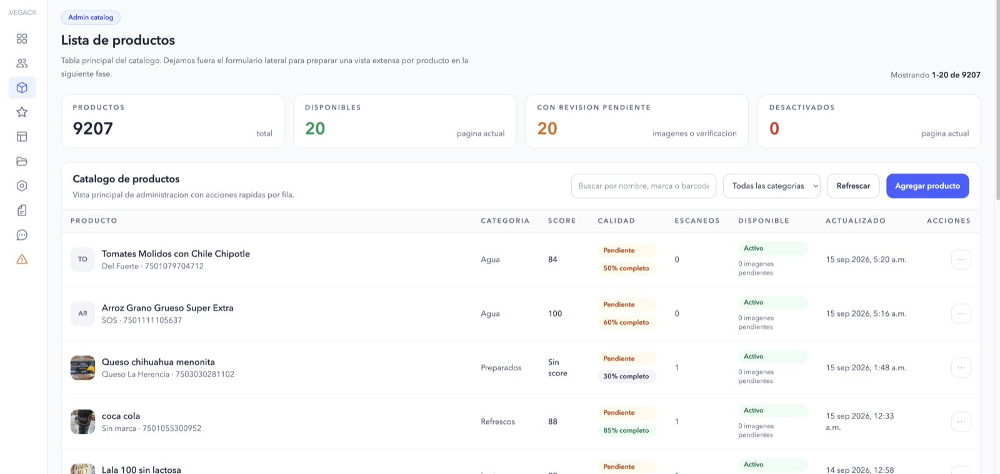

---

## 🎯 Sobre el proyecto

México tiene uno de los sistemas de etiquetado más estrictos del mundo, pero los sellos negros solo dicen *qué está mal*, no *qué tan mal*, ni *qué elegir en su lugar*. Dos productos pueden tener el mismo sello de azúcares con cantidades muy distintas, y los sellos no consideran a la persona (diabetes, hipertensión, compra para niños).

**Sano convierte información que ya existe en una decisión simple en el momento en que importa.**

| Área | Qué hice |
|---|---|
| Producto | Definí propuesta de valor, diferenciadores y alcance |
| App móvil | Expo + TypeScript: escaneo, score, perfil |
| Dashboard | Electron + React: catálogo, usuarios, score, reportes, soporte |
| Backend | Gateway NestJS con Docker Compose |
| IA | Extracción de datos de etiquetas con un modelo de visión local |
| Web | Landing en Astro |
| Calidad | Documentación por módulo, archivos `TODO` / `PENDIENTES` / `HECHO` versionados |

## 🛠️ Tecnologías

`React Native / Expo` · `Electron` · `React` · `TypeScript` · `Tailwind CSS v4` · `Zustand` · `NestJS` · `Docker` · `Astro` · `ONNX Runtime` · `llama.cpp (Qwen2.5-VL)` · `Cloudflare R2`

## 📱 App móvil

Onboarding → inicio → detalle del producto con score, Nutri-Score, NOVA, sellos NOM-051, ingredientes y alternativas más sanas. Hecha con Expo (`app.config.ts` dinámico, builds con EAS y guía de publicación).

  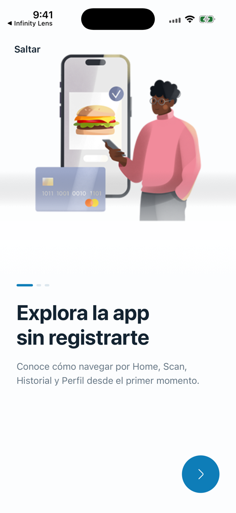
  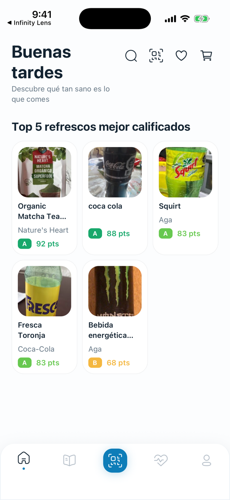
  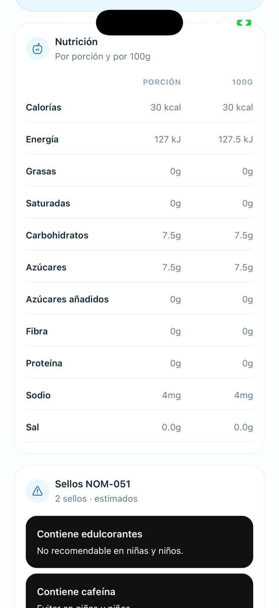
  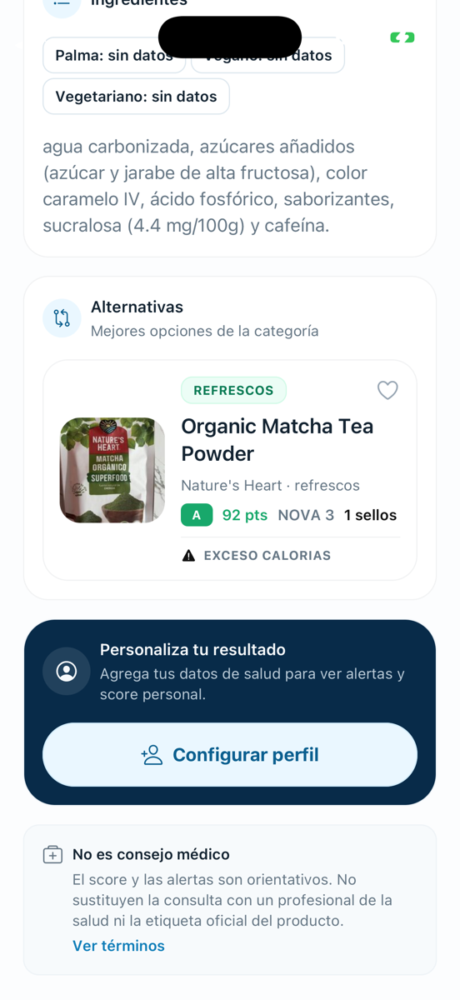

> La pantalla del escáner requiere un iPhone físico (el simulador no tiene cámara), por eso no aparece en las capturas.

## 🖥️ Dashboard de escritorio

Un panel de operación para el equipo: KPIs con filtros de rango y tendencia diaria, **catálogo de 9,207 productos** con búsqueda, filtro por categoría, completitud y estado de revisión de imágenes, un módulo de salud del score y una cola de moderación de reportes.

  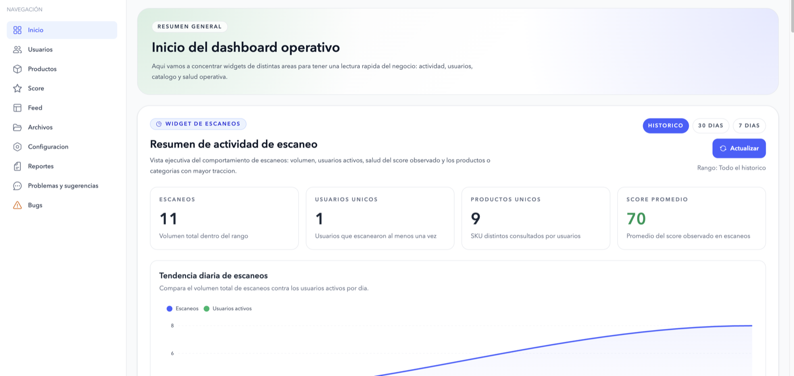
  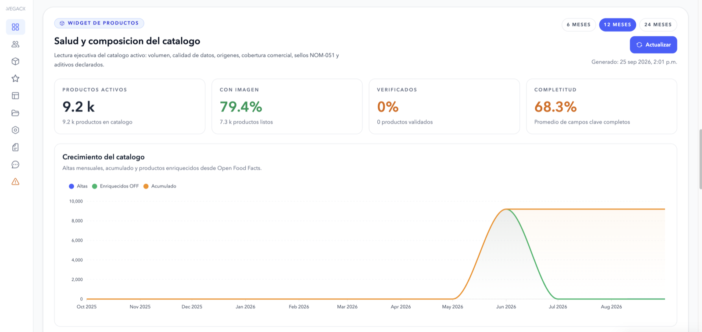

  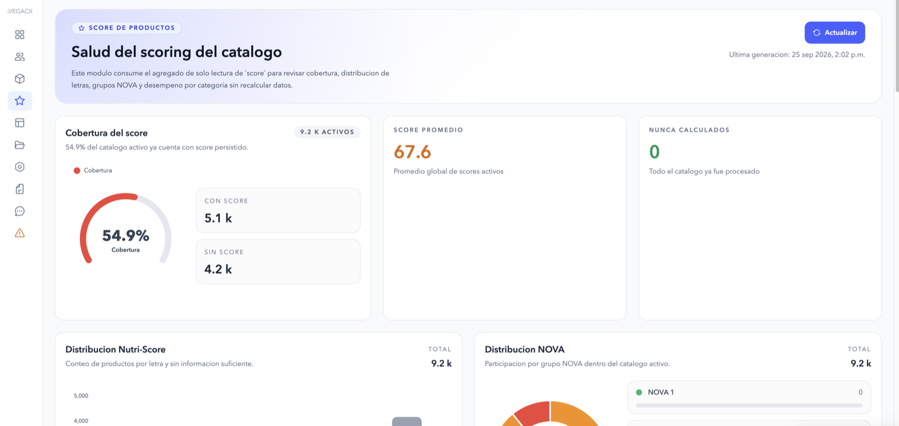
  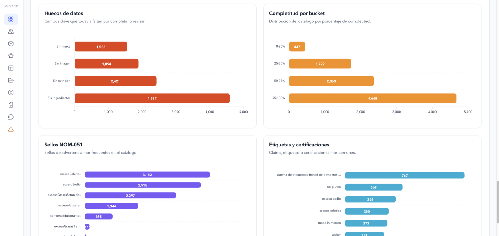

  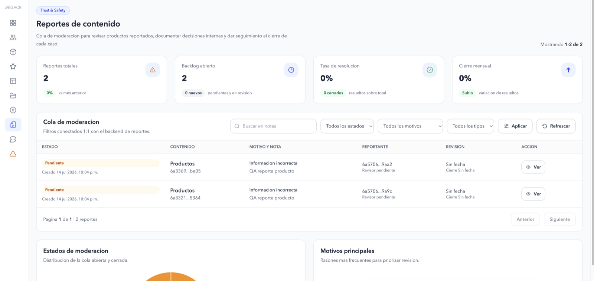

> Las cifras del inicio (11 escaneos, 1 usuario) son **datos de prueba**, no resultados.

## 🌐 Landing

Astro + React + Tailwind v4, desplegable en Cloudflare (`wrangler`): hero con tarjeta de score, comparador interactivo y reporte semanal.

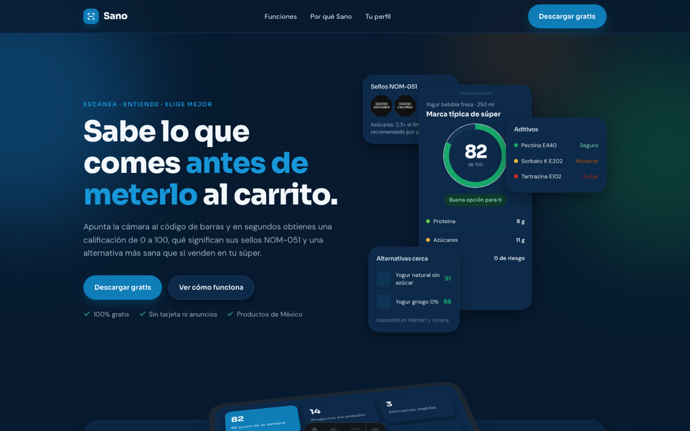

## 🧠 Decisiones técnicas clave

### Arquitectura de escritorio segura (Electron)
- Separación estricta `main` / `preload` / `renderer`.
- **Los JWT nunca llegan a React**; el refresh token se cifra con `safeStorage` (Keychain de macOS).
- Lista blanca de hosts para la API y los enlaces externos; se valida el origen de cada llamada IPC.

### IA local, decidida con una prueba de concepto
Antes de implementar hice un POC: un modelo de 2B en CPU lee bien sellos y marca pero **falla la tabla nutrimental**; el de 7B la lee completa. Decisión: correr **Qwen2.5-VL-7B** como subproceso del proceso principal con `llama-server` (Metal/GPU), sin tocar el CSP ni abrir una segunda ventana.

- Salida forzada por **esquema JSON**, análisis en cola imagen por imagen.
- **Validación del dígito de control EAN-13** del código de barras.
- El asistente recibe tres fotos (frente, lateral, trasera) y **prellena el formulario**; el equipo revisa y confirma.

### Procesamiento de imágenes
Subida presigned a **Cloudflare R2**, editor de recorte y **remoción de fondo con un modelo ONNX local**.

### Estructura modular para un dashboard que crece
`modules/<dominio>/{pages,components,services,store,types}`, un store de Zustand por módulo y `shared` solo para contratos entre procesos.

### Backend y despliegue
Gateway NestJS con `docker-compose`; HTTPS y hosts permitidos son variables de entorno obligatorias en producción.

## 🌱 Siguientes pasos (lista honesta)

- Empaquetar `llama-server` y los modelos GGUF con electron-builder.
- Recorte por imagen para encuadrar la tabla nutrimental.
- Lector de código de barras dedicado (zxing) como respaldo del modelo.
- Pruebas automatizadas del módulo de visión.
- Soporte Windows (DPAPI) y Linux fuera de alcance por ahora.

## 📄 Nota

Este repositorio contiene **solo documentación**; el código fuente es privado. Con gusto lo recorro en una entrevista.

## 📬 Contacto

**Infinity dev by Frank** · [GitHub](https://github.com/InfinityByFrank) · [Infinity](https://infinitydev.agency) · [Portfolio](https://portfolio.infinitydev.agency)
